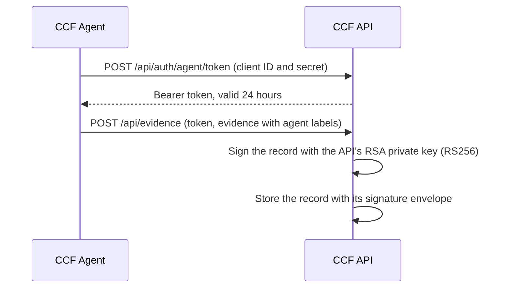

# Evidence signing

Evidence records the Continuous Compliance Framework (CCF) API stores are either **Signed** or **Unsigned**: when you submit evidence with a valid token, the API signs the record with its own key, so anyone with access can later check that the record hasn't changed since it was submitted and who submitted it. This page is for **operators** who want their agents' evidence to arrive signed, and for **compliance and GRC users** who read the **Signature** tab and its checks.

This page documents API `v0.22.5`, agent `v0.9.6` and UI `v2.15.2`.

## How it works

Whether a record ends up signed depends on all three components: the agent that submits it, the API that stores it, and the key the API signs with.



### The agent authenticates and sends evidence

The agent holds a service account key of a registered agent: its client ID and client secret go in `api.auth` (see the [agent configuration reference](/agent/configuration)). With them set, the agent:

1. Exchanges the credentials for a token: `POST /api/auth/agent/token`, with the client ID and secret as HTTP basic auth. The API answers with `access_token`, `token_type` (`Bearer`) and `expires_in` (`86400`, 24 hours).
2. Fetches the token on the first request that needs it and reuses it. It asks for a new one when the cached token is within a minute of expiring, and once more after any `401` on a protected call, retrying that call with the new token.
3. Sends each evidence record to `POST /api/evidence`, expecting `201 Created`. Its heartbeats go to `POST /api/agent/heartbeat`, once a minute in daemon mode.

The agent labels every record it sends. Plugin evidence carries:

| Label | Value |
|---|---|
| `_agent` | The agent's identity: its `api.auth.client_id`, or the `KUBERNETES_POD_NAME` (or `KUBERNETES_POD`) environment variable without credentials, or a SHA-256 hash of its configuration without either. |
| `_plugin` | The plugin's name, as configured under `plugins`. |
| `_policy` | The policy bundle's package name, set by the policy manager. |
| `_policy_path` | The policy path the plugin was given, set by plugins built on the agent library. |
| `plugins.<name>.labels` | Every label you configure for the plugin. The plugin's own labels with the same names win. |

The agent's own run evidence carries `_agent` plus `tool=ccf` and `type=operations`.

The agent also owns four props that record where each plugin and policy bundle came from: `_plugin_source`, `_plugin_digest`, `_policy_source` and `_policy_digest`, and the `agent-config-revision` prop (namespace `https://compliance-framework.github.io/ns`) when a remote configuration overlay is applied. A plugin's own values for these are replaced.

The agent signs nothing itself. It has no signing key: the API is the signer, and the record's provenance rests on the token that submitted it.

### The API signs on ingest

The API signs a record inside the same transaction that stores it, and stores the signature envelope alongside the record. It signs when the submission carried a token that identified its submitter, a user or an agent. **It stores a record unsigned when the submission was anonymous**: by default the evidence ingest route also accepts requests without a token, so a script (or an agent without `api.auth`) that posts evidence anonymously gets an **Unsigned** record. There is no setting that turns signing off: with an authenticated submitter, the record is always signed. Evidence submitted to `POST /api/evidence/batches` is stored and signed by a background worker, but its signature is dated when the API accepted the batch, while the submitter's token was still valid.

The signature is an envelope the API computes as follows:

- **What the signature covers.** The API canonicalizes the record, hashes it with SHA-256, and signs that hash. The canonical document holds these fields, each omitted when empty except `status`: `uuid`, `title`, `description`, `remarks`, `start`, `end`, `expires`, `props`, `links`, `origins`, `activities`, `inventory_items`, `components`, `subjects`, `subject_references`, `status`, `back_matter` and `labels`. Lists are sorted so equal content always hashes the same, times are written in UTC, and `status` keeps only its `state`, `reason` and `remarks`.
- **What the signature leaves out.** The record's database ID and its created and updated timestamps never enter the hash. Neither does the signature itself, the implemented-component links that hang off inventory items (later submissions add to them, so signing them would invalidate earlier signatures), nor anything in `status` beyond `state`, `reason` and `remarks`, such as its timestamp.
- **Which key signs, and which verifies.** The API signs with its RSA private key and verifies with its RSA public key, the same 2048-bit key pair that signs the JWTs, from `CCF_JWT_PRIVATE_KEY` and `CCF_JWT_PUBLIC_KEY`. The algorithm is `RS256`, and the envelope records it, a version (`v1`), the time it signed (`signed_at`), the content hash (`content_hash`: `algorithm` `SHA-256` and the hex `value`), the signer, the submitter's token claims, and the signed payload itself (`jws`).
- **When the key isn't persistent.** Without both key settings, the API generates a fresh key pair in memory at each start, as `api bootstrap` does on disk. Every earlier evidence signature then fails verification against the new public key: the UI reports it as **Invalid** with the error "stored JWS signature is invalid". Rotating the key files has the same effect on signatures made with the old key: the API keeps no history of old keys, so those records can no longer verify. Set the two settings to survive restarts and rotations.
- **The signer it records.** The envelope names the submitter: for an agent, `type` `agent` with the agent's ID and name and the `credential_id` of the service account key that authenticated; for a user, `type` `user` with their email and name. Alongside it, the claims snapshot holds the submitter's token: `subject`, `issuer` (`compliance-framework`), `issued_at`, `expires_at`, `not_before`, and for agents the `agent_id`, `credential_id` and `auth_method` (`service_account`).

### The UI verifies a record

On the evidence detail page the UI reads the stored envelope with `GET /api/evidence/{id}/signature` and, when you select **Verify**, runs a fresh check with `POST /api/evidence/{id}/verify`. Both endpoints require a signed-in user with `evidence` `read` (the `admin`, `contributor`, `auditor` and `viewer` roles have it; agent tokens are refused there). Verification never changes the record: it recomputes the content hash and checks the stored signature against it.

## Before you start

- API `v0.22.5`, agent `v0.9.6` and UI `v2.15.2` or later of each.
- On the API: persistent signing keys in `CCF_JWT_PRIVATE_KEY` and `CCF_JWT_PUBLIC_KEY`. Run `api bootstrap` once to create the key files.
- On the agent: a registered agent with a service account key, and its client ID and secret in `api.auth`. Register the agent under **Global** > **Integrations** > **Agents** and create a key there.
- To send evidence, the sender needs `evidence` `create`; registered agents have it. To read signatures and verify in the UI, you need `evidence` `read`.
- To confirm which keys your users check signatures against, `GET /api/auth/publickey.pub` returns the API's current public key in PEM form.

## Enable it

Signing needs no switch. For your agents' evidence to arrive signed, set credentials on the agent and persistent keys on the API:

1. Register the agent and create a service account key under **Global** > **Integrations** > **Agents**. Copy the **Client ID** and **Client Secret**: the secret is shown once.
2. Point the agent at the API and give it the key, in its configuration file:

   ```yaml
   api:
     url: https://ccf.example.com
     auth:
       client_id: 3f8a2b1e-7c6d-4e5f-9a0b-1c2d3e4f5a6b
       client_secret: <the client secret>
   ```

   The credentials can instead come from `CCF_API_AUTH_CLIENT_ID` and `CCF_API_AUTH_CLIENT_SECRET`. Both keys or neither: a half-configured `api.auth` fails validation.
3. On the API, pin the key pair so signatures survive restarts:

   ```sh
   api bootstrap --private-key /etc/ccf/private.pem --public-key /etc/ccf/public.pem
   ```

   ```sh
   CCF_JWT_PRIVATE_KEY=/etc/ccf/private.pem
   CCF_JWT_PUBLIC_KEY=/etc/ccf/public.pem
   ```

4. Optional: to make **Unsigned** evidence impossible to store, reject submissions without a token:

   ```sh
   CCF_STRICT_DISABLE_PUBLIC_AGENT_ENDPOINTS=true
   ```

   Then evidence submissions without a valid token are refused with `401`, instead of being accepted as **Unsigned**.

## Use it

### Read the badge

The evidence detail page shows a badge next to its title: **Signed** when the record has a stored signature, **Unsigned** when it doesn't. While the page fetches the stored signature it reads **Loading...**, and **Unavailable** when that request fails.

### Run verification

1. Open the record's **Signature** tab and select **Verify** (it becomes **Re-verify** after a run). The **Verification** section fills in.
2. Read the overall pill: **Valid** when every check passed, **Invalid** when any failed. Beside it, "Verification status:" echoes the stored status, `signed` or `unsigned`. For an **Unsigned** record, verification has nothing to check: the pill reads **Invalid**, the status line reads `unsigned`, and all four checks show **Fail**.
3. Each check shows **Pass** or **Fail**. What each one compares, and what a **Fail** means:

| Check | What it compares | A **Fail** means |
|---|---|---|
| **Hash Match** | The hash recomputed from the record as stored now, against the `content_hash` in the envelope. | The record changed after it was signed. |
| **Signature Valid** | The envelope as stored, against the payload that was actually signed. | The stored envelope no longer matches what was signed. |
| **Temporal Valid** | The time the API signed the record, against the submitter token's validity window (`issued_at`, `not_before`, `expires_at`). | The signature claims a time outside the token's validity. |
| **Signed Content Matches** | The hash recomputed now, against the hash inside the signed payload. | The record diverged from the content the signature attests to. |

4. Below the checks, **Verified Content Hash** shows the recomputed hash's algorithm and value, and **Verification Errors** lists one line per failed check, as the API phrased it.


Verification checks integrity only: the evidence's compliance status still comes from the check that produced it.

### Read the signer

**Signature Details** shows the stored envelope in four cards:

- **Envelope**: **Version**, **Algorithm**, **Signed At**, **Content Hash**.
- **Signer**: **Type**, **Name**, **Email**, **ID**, **Credential ID**.
- **Claims**: the submitter's token: **Subject**, **Issuer**, **Token Kind**, **Issued At**, **Expires At**, **Not Before**, **Given Name**, **Family Name**, **Agent ID**, **Credential ID**, **Auth Method**.
- **JWS**: the signed payload itself.

For an agent's evidence, match the signature to a registered agent like this:

- **Signer** > **Name** is the registered agent's name: find it in the **Name** column of **Global** > **Integrations** > **Agents**. **Claims** > **Agent ID** is that agent's ID, and **Signer** > **ID** repeats it.
- **Credential ID** (in both **Signer** and **Claims**) is the ID of the service account key the agent authenticated with. The Agents page identifies its keys by **Name** and **Client ID** in the **Service Account Keys** tab, not by that ID; to see it, ask the API for the agent's keys: `GET /api/admin/agents/{agent-id}/keys` returns each key's `id`, and the credential matches the key whose `id` it equals. The **Client ID** column instead holds the credential the agent authenticates with (the `client_id` of `api.auth`).
- A **Type** of `user` means a person submitted the record, not an agent: **Email** names them.
- The key that signed is the API's, not the agent's: a signature proves the API received the record from that signer, and that the record hasn't changed since. To trust it independently, fetch the API's public key out of band (`GET /api/auth/publickey.pub`) and check the `jws` yourself.

## Troubleshooting

- **The agent logs `agent auth failed with status code: 401`:** the token exchange was refused. `401` means the credentials didn't match a usable key: no credentials were sent at all, the client ID is unknown, the secret is wrong, or the key or its agent no longer exists in the database. Check the client ID and secret in `api.auth`, and that the agent is still registered.
- **The agent logs `agent auth failed with status code: 403`:** the credentials matched but the key or agent can't be used. The API's causes are `agent key is revoked` (the key was revoked on the **Service Account Keys** tab), `agent key is expired` (the key has an expiry that has passed), and `agent is inactive` (the agent is switched off on the **Agents** page).
- **The agent logs `agent auth failed with status code: 500`:** the API failed to look up the key or agent, to generate the token, or to record the key's last-used and the agent's last-authenticated times. Check the API's logs and its database.
- **The agent logs `agent auth response missing access_token`:** something in front of the API (a proxy or cache) answered the token request without a token. Check the path from the agent to the API.
- **Records show as Unsigned:** they were submitted without a token, and the UI gives them the **Unsigned** badge. An agent does this when `api.auth` is unset (it then sends evidence unauthenticated), and scripts do it when they post to `POST /api/evidence` without a bearer token. Give the sender credentials, or set `CCF_STRICT_DISABLE_PUBLIC_AGENT_ENDPOINTS=true` so the API refuses them. Older records stay **Unsigned**: the API signs at ingest and never goes back to sign earlier records.
- **Every earlier record fails with "stored JWS signature is invalid":** the API's key pair is no longer the one that signed them. It regenerated one at a restart (the key settings were unset; its log says "No JWT key files have been provided"), or you rotated the keys. Signatures made with the old key don't verify against the new public key: the API keeps no key history.
- **Hash Match** and **Signed Content Matches** fail, or **Signature Valid** fails: the stored record no longer matches what was signed, which a later edit of the record explains. If nothing edited it, investigate who could write to the API's database.
- Only **Temporal Valid** fails: the signature's `signed_at` falls outside the submitter token's window, which normal submissions and batch accepts don't produce. Compare **Claims** > **Issued At**, **Not Before** and **Expires At** with **Signed At**, and check the clocks of the machines involved.
- **`401 Unauthorized` on the signature endpoints:** you're not signed in as a user. Agent tokens can't read signatures; sign in to the UI, or get a user token with `POST /api/auth/token`.
- **`403 forbidden` on the signature endpoints:** your role lacks `evidence` `read`. See [Authentication and permissions](./authentication-and-permissions.md).

## Related

- [Authentication and permissions](./authentication-and-permissions.md): tokens, the JWT key settings and the roles that grant `evidence` `read` and `create`.
- [Configuration reference](./configuration.md): `CCF_JWT_PRIVATE_KEY`, `CCF_JWT_PUBLIC_KEY` and `CCF_STRICT_DISABLE_PUBLIC_AGENT_ENDPOINTS`.
- [Evidence in the UI](/ui/features/evidence): searching records and the tabs around the **Signature** tab.
- [Agent overview](/agent): installing the agent and authenticating it to the API.
- [API overview](./index.md)
