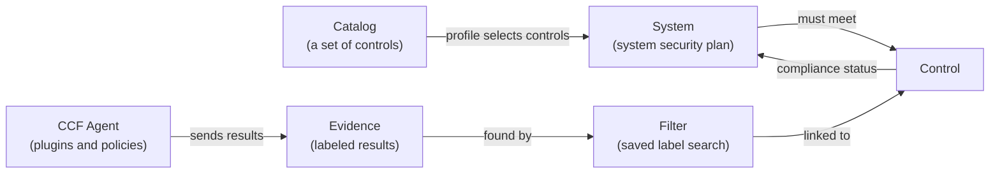

# Concepts

The Continuous Compliance Framework (CCF) measures your **systems** against **controls** from **catalogs**, using **evidence** that **filters** link to those controls. This page is for everyone who is new to CCF: **compliance and GRC users**, **operators** and **developers**.

## How it fits together

1. A catalog lists the controls you can be measured against.
2. A system says which of those controls it must meet.
3. CCF Agents run policies and send evidence about the system to the API.
4. A filter finds the evidence that belongs to a control.
5. The API reports the system's compliance from what the filters find.

The sections below define each concept. The [glossary](./glossary.md) covers the wider vocabulary.

## System

A system is the thing you're answerable for: an application, a platform or a cloud account. In CCF, you describe it with an OSCAL system security plan (SSP): its components, the profile of controls it must meet, and how it implements them. A system is also the scope that evidence and compliance are shown for.

See [Systems](/ui/features/systems) in the UI guide.

## Control

A control is a requirement that a system has to meet, such as a policy or a safeguard (also called a requirement). It has an ID, a statement of what's required, and parts that explain it. For each control, the system's SSP records how it's implemented, and CCF shows whether the evidence satisfies it.

See [Controls and the Compliance Map](/ui/features/controls).

## Catalog

A catalog is an organized collection of controls, in OSCAL format. NIST SP 800-53 is a catalog. Your own internal policies can be a catalog too. A **profile** selects the controls of one or more catalogs that apply to a system, and the system's SSP attaches the profile.

See [Control definitions](/ui/features/control-definitions).

## Evidence

Evidence is a result, satisfied or not, about one subject, with labels that say where it comes from, such as `_plugin=apt-versions` or `environment=production`. CCF Agents produce it: a plugin collects data from the target, and a policy evaluates it. Anything else with an API token can send evidence too. New evidence with the same stable identifier updates its stream, and the earlier records become its history.

See [Evidence](/ui/features/evidence) and the [architecture](/api/architecture/agents) of the agent.

## Filter

A filter is a saved search over evidence labels, for example `environment=production AND _plugin=apt-versions`. You link it to the controls it's evidence for. Evidence that matches the filter counts toward those controls, so new evidence is picked up with no further work. A filter can follow the scope of a system, so it only finds evidence that belongs to it.

See [Evidence filters](/ui/features/evidence#evidence-filters).
