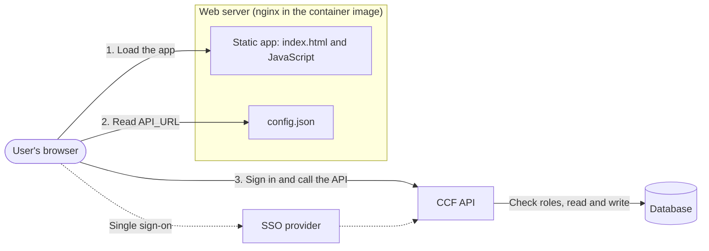

# UI overview

The Continuous Compliance Framework (CCF) UI is the web app where you work with your compliance data: systems, evidence, controls, risks and workflows. It runs in the browser and reads and writes everything through the API. This page is for **operators** who deploy the UI, and for **compliance and GRC users** who sign in to it.

## Deploy the UI

The UI is a static web app. Each release publishes the container image `ghcr.io/compliance-framework/ui`, for `linux/amd64` and `linux/arm64`, tagged with the release version, such as `2.15.2` and `2.15`. The image serves the app with nginx on port `80`.

1. Write a `config.json` with the address of the API:

   ```json
   {
     "API_URL": "https://ccf-api.example.com"
   }
   ```

2. Run the image with the file mounted at `/app/config.json`:

   ```sh
   docker run -p 8000:80 -v "$PWD/config.json:/app/config.json:ro" ghcr.io/compliance-framework/ui:2.15.2
   ```

3. Let the API accept calls from the UI's address: add it to the API's `CCF_API_ALLOWED_ORIGINS`, and set `CCF_WEB_BASE_URL` to it so links in emails point to the UI. See the [API configuration reference](/api/configuration).

The UI reads `config.json` each time it loads, and nginx serves it uncached, so a change applies when users reload the page. Every setting is in the [configuration reference](./configuration.md).

To build the UI yourself, use Node.js 20:

```sh
git clone --branch v2.15.2 https://github.com/compliance-framework/ui.git
cd ui
npm install
npm run build
```

The app is written to `dist/`. Serve it from any web server that sends unknown paths to `index.html`, as the image's nginx configuration does.

## How it works

The UI has no server-side logic of its own. The browser downloads the static app once, then every screen talks to the API.



1. **Load the app.** The web server sends the static files. Paths the server doesn't know go to `index.html`, so the app handles page addresses itself in the browser.
2. **Read `config.json`.** The app fetches `config.json` from its own address and takes the API address from `API_URL`. A UI built with `VITE_API_URL` skips this step. See the [configuration reference](./configuration.md).
3. **Call the API.** The browser sends every request straight to the API, so the API address must be reachable from your users' machines, and the API must list the UI's address in `CCF_API_ALLOWED_ORIGINS`. The web server never proxies these calls.
4. **Sign in.** You sign in with a password or with single sign-on through the API. The API decides what you can see and change from your roles, and the UI only shows the sidebar entries those roles allow.

Because the app runs in the browser, `config.json` is public: never put a secret in it. The data itself, including systems, evidence, controls, risks and workflows, lives behind the API and its database, not in the UI.

## Sign in

Open the UI and sign in in one of two ways:

- With the email and password of the user an administrator created for you, then **Login**. **Forgot Password?** emails you a reset link.
- With single sign-on: select **Continue with** followed by your provider's name. The buttons list the providers the API has set up; when there are none, the page says so.

To sign out, select **Logout** at the bottom of the sidebar or in the profile menu.

## Find your way around

- The **sidebar** on the left leads to every area of the UI. You only see the entries your permissions allow. See [Navigation](./navigation.md).
- The **header** has the **Active System** menu, where you choose the system security plan (SSP) that the pages under **This System** in the sidebar work on.
- The **profile menu** at the top right opens **My Tasks**, with the number of workflow tasks waiting for you, **Preferences** and **Logout**.

What you can see and change depends on your roles in the API. See [Authentication and permissions](/api/authentication-and-permissions).

## Preferences

Under **Preferences** you choose where CCF sends you notifications, by email or Slack:

- **Evidence Notifications**: evidence digest alerts.
- **Task Notifications**: alerts when a task becomes available, and the daily task digest.
- **Risk Notifications**: risk alerts.

To get notifications in Slack, link your Slack account in the **Slack** section. When the API doesn't have Slack set up, the section says so.

## Related

- [Configuration reference](./configuration.md)
- [Navigation](./navigation.md)
- [API overview](/api)
